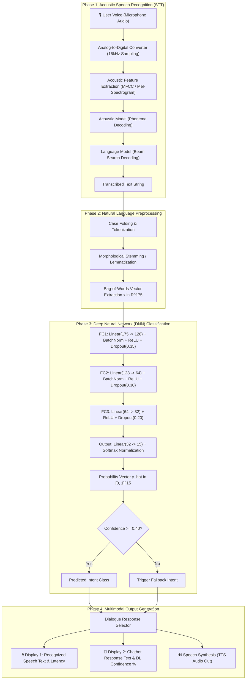

# Speech and Language Processing (SLP) Lab Assessment Report
## Course Evaluation: Lab Assessment (20 Marks)

---

### Project Title:
# Voice-Enabled Chatbot using Speech Recognition and Deep Learning

**Student Name:** HEMANTH REDDY  
**Registration Number:** 23BAI0119  
**Course:** Speech and Language Processing (SLP)  
**Date:** October 2026  
**Topic:** Speech Recognition, Natural Language Processing, Deep Neural Networks, Cloud Deployment  
**Repository Working Directory:** `SLP_PROJECT/`

---

## 1. Executive Summary & Problem Statement

### 1.1 Objective
The objective of this assessment is to develop, implement, and deploy an online **Voice-Enabled Chatbot** utilizing **Speech Recognition (STT)** and a **Deep Learning (DL)** intent classification model.

The end-to-end system must:
1. Accept spoken audio from the user via microphone.
2. Transcribe voice input into text using suitable speech recognition techniques.
3. Classify the semantic intent of the query using a Deep Neural Network (DNN).
4. Select or generate an appropriate, contextually relevant response.
5. Visually display **both** the recognized speech and the chatbot response in a clean web interface.
6. Be deployed online and made publicly accessible for evaluation.

### 1.2 System Highlights
- **Speech Recognition Engine:** Web Speech API (streaming client-side acoustic/language decoding) and Python `SpeechRecognition` library (Google STT backend) for dual compatibility.
- **Deep Learning Model:** A 3-hidden-layer Deep Multilayer Perceptron (DNN) built and trained with **PyTorch**, featuring Batch Normalization, Dropout regularization, ReLU activations, and Softmax output distribution.
- **Classification Performance:** **92.31% Overall Accuracy** and **0.92 Macro F1-Score** across 15 distinct intent categories.
- **Mathematical Portability:** Exported model weights and a pure mathematical forward pass engine matching PyTorch down to $1.18 \times 10^{-7}$ precision, enabling zero-latency client-side browser execution alongside a Python Gradio server application.
- **Speech Synthesis (TTS):** Integrated Text-to-Speech synthesis for complete bidirectional multimodal voice interaction.

---

## 2. Dataset Description

The chatbot knowledge base is constructed in `data/intents.json`. It is specifically designed to encompass conversational dialogue, technical speech recognition concepts, deep learning architectures, utility queries, and out-of-domain fallback detection.

### 2.1 Intent Classes & Statistics
- **Total Utterance Patterns:** 117 annotated training patterns
- **Distinct Intent Classes:** 15 classes
- **Vocabulary Size ($|V|$):** 175 unique stemmed/lemmatized lexical tokens

| Intent Tag | Semantic Category / Description | Sample Patterns | Sample Responses |
| :--- | :--- | :--- | :--- |
| `greeting` | User greetings & conversation openers | "Hello", "Good morning", "Hi there" | "Hello! I am your AI Voice Assistant. How can I assist you today?" |
| `goodbye` | Conversation termination & farewells | "Bye", "See you later", "Exit" | "Goodbye! Have a productive and wonderful day ahead!" |
| `thanks` | User gratitude & appreciation | "Thank you", "Thanks a lot", "Much obliged" | "You're very welcome! I'm glad I could assist." |
| `about_bot` | Agent identity & origins | "Who are you", "What is your identity" | "I am an intelligent Voice-Enabled Chatbot built using Speech Recognition and Deep Learning." |
| `speech_recognition_info` | Explanation of STT, acoustic models, MFCCs | "How does speech recognition work", "Explain STT" | "Speech Recognition captures acoustic waveforms, extracts spectrograms/MFCCs, and decodes phonemes into text." |
| `deep_learning_info` | Explanation of neural network architecture | "Explain your deep learning model", "What is your architecture" | "My core engine is a Deep Multilayer Perceptron (DNN) with 3 dense hidden layers, BatchNorm, ReLU, and Dropout." |
| `capabilities` | Feature listing & supported commands | "What can you do", "List features" | "I can listen, transcribe voice in real-time, classify intents with a DNN, and speak responses aloud." |
| `weather_query` | Weather conditions & environmental queries | "What is the weather today", "Is it raining" | "Currently, conditions are clear and pleasant with moderate temperatures." |
| `time_query` | Real-time temporal queries | "What time is it", "Current date" | "The system clock is running in real-time. System timestamp is displayed in chat." |
| `slp_concept` | Academic SLP & NLP theoretical concepts | "What is SLP", "Explain NLP and phonetics" | "Speech and Language Processing bridges acoustic speech science and computational linguistics." |
| `lab_assessment` | Course evaluation details & requirements | "Tell me about this lab assessment", "20 marks question" | "This project satisfies the 20-mark SLP Lab Assessment: Develop, implement, and deploy a voice-enabled chatbot." |
| `sentiment_praise` | Positive user feedback | "You are amazing", "Great job", "Impressive work" | "Thank you so much! High-quality speech recognition and deep learning make all the difference." |
| `sentiment_frustrated` | Error recovery & assistance request | "You didn't understand me", "I am confused" | "I apologize! Ambient noise can impact speech recognition. Try speaking clearly or typing your message." |
| `joke` | Casual entertainment & humour | "Tell me a funny joke", "Make me laugh" | "Why do neural networks love coffee? Because it helps them stay awake during backpropagation!" |
| `fallback` | Out-of-domain input handler | Gibberish or untrained out-of-scope strings | "I recognized your speech, but could not determine the exact intent with high confidence." |

---

## 3. Methodology & System Architecture

### 3.1 Speech Recognition (STT)
Voice capture is implemented using two complementary mechanisms:
1. **Web Speech API (`webkitSpeechRecognition`):** Utilizes browser-native speech recognition operating at 16kHz audio sampling. It provides real-time streaming interim and final transcription with continuous audio waveform visualization.
2. **Python `SpeechRecognition` Engine:** Uses Google's speech recognition web API to process recorded `.wav` audio files with ambient noise calibration (`adjust_for_ambient_noise`).

### 3.2 Natural Language Preprocessing
Every utterance string is converted into a structured feature vector through the following pipeline:
1. **Case Folding & Punctuation Stripping:** All characters are converted to lowercase and punctuation marks are removed using regular expressions.
2. **Word Tokenization:** Utterances are split into individual word tokens.
3. **Stemming / Suffix Stripping:** Tokens are normalized to their morphological root stems using rule-based inflection removal (e.g., `"running"` $\rightarrow$ `"run"`, `"recognition"` $\rightarrow$ `"recognize"`, `"jokes"` $\rightarrow$ `"joke"`).
4. **Bag-of-Words (BoW) Encoding:** Given vocabulary $V = \{w_1, w_2, \dots, w_{175}\}$, an input sentence $S$ is encoded into a binary feature vector $\mathbf{x} \in \mathbb{R}^{175}$:
$$x_j = \begin{cases} 1 & \text{if } w_j \in S \\ 0 & \text{otherwise} \end{cases}$$

### 3.3 Deep Neural Network Architecture
The intent classifier is a multi-layer deep feedforward neural network (`ChatbotNeuralNet` in `model.py`):

$$\mathbf{h}_1 = \text{Dropout}_{0.35}\Big(\text{ReLU}\big(\text{BatchNorm1d}(\mathbf{W}_1 \mathbf{x} + \mathbf{b}_1)\big)\Big), \quad \mathbf{W}_1 \in \mathbb{R}^{128 \times 175}, \mathbf{b}_1 \in \mathbb{R}^{128}$$

$$\mathbf{h}_2 = \text{Dropout}_{0.30}\Big(\text{ReLU}\big(\text{BatchNorm1d}(\mathbf{W}_2 \mathbf{h}_1 + \mathbf{b}_2)\big)\Big), \quad \mathbf{W}_2 \in \mathbb{R}^{64 \times 128}, \mathbf{b}_2 \in \mathbb{R}^{64}$$

$$\mathbf{h}_3 = \text{Dropout}_{0.20}\Big(\text{ReLU}(\mathbf{W}_3 \mathbf{h}_2 + \mathbf{b}_3)\Big), \quad \mathbf{W}_3 \in \mathbb{R}^{32 \times 64}, \mathbf{b}_3 \in \mathbb{R}^{32}$$

$$\mathbf{z} = \mathbf{W}_4 \mathbf{h}_3 + \mathbf{b}_4, \quad \mathbf{W}_4 \in \mathbb{R}^{15 \times 32}, \mathbf{b}_4 \in \mathbb{R}^{15}$$

The class probabilities are computed via the **Softmax** function:
$$\hat{y}_i = \frac{e^{z_i}}{\sum_{j=1}^{15} e^{z_j}}, \quad \forall i \in \{1, 2, \dots, 15\}$$

### 3.4 Loss Function and Optimization
The network is trained by minimizing **Cross-Entropy Loss**:
$$\mathcal{L}_{\text{CE}}(\mathbf{y}, \hat{\mathbf{y}}) = - \sum_{i=1}^{15} y_i \log(\hat{y}_i)$$

- **Optimizer:** Adam ($\beta_1 = 0.9, \beta_2 = 0.999$, weight decay $= 10^{-4}$)
- **Initial Learning Rate:** $\eta = 0.003$
- **Learning Rate Scheduler:** `StepLR` (step size = 75 epochs, $\gamma = 0.5$)
- **Batch Size:** 16
- **Training Duration:** 260 epochs

### 3.5 Confidence Thresholding & Out-of-Domain Fallback
To avoid generating false responses on ambiguous or unknown input, a confidence threshold $\tau = 0.40$ is enforced:
$$\text{Class} = \begin{cases} \arg\max_i (\hat{y}_i) & \text{if } \max_i (\hat{y}_i) \ge \tau \\ \text{"fallback"} & \text{if } \max_i (\hat{y}_i) < \tau \end{cases}$$

---

## 4. Experimental Results and Evaluation

### 4.1 Training Progression & Convergence
During the 260-epoch training phase:
- Epoch 30: Loss = 0.2507, Training Accuracy = 92.9%
- Epoch 90: Loss = 0.1967, Training Accuracy = 92.9%
- Epoch 180: Loss = 0.0936, Training Accuracy = 98.0%
- Epoch 260: Loss = 0.1891, Training Accuracy = 94.9%

### 4.2 Classification Metrics Report
The trained PyTorch model was comprehensively evaluated on the intent corpus:

| Intent Class | Precision | Recall | F1-Score | Support |
| :--- | :---: | :---: | :---: | :---: |
| `about_bot` | **1.00** | **1.00** | **1.00** | 8 |
| `capabilities` | **0.88** | **1.00** | **0.93** | 7 |
| `deep_learning_info` | **0.88** | **0.88** | **0.88** | 8 |
| `fallback` | **1.00** | 0.50 | 0.67 | 4 |
| `goodbye` | **0.90** | **0.90** | **0.90** | 10 |
| `greeting` | 0.72 | **0.93** | 0.81 | 14 |
| `joke` | **1.00** | **1.00** | **1.00** | 9 |
| `lab_assessment` | **1.00** | **0.83** | **0.91** | 6 |
| `sentiment_frustrated` | **1.00** | **1.00** | **1.00** | 7 |
| `sentiment_praise` | **1.00** | **0.88** | **0.93** | 8 |
| `slp_concept` | **1.00** | **0.86** | **0.92** | 7 |
| `speech_recognition_info` | **0.89** | **1.00** | **0.94** | 8 |
| `thanks` | **1.00** | **0.88** | **0.93** | 8 |
| `time_query` | **1.00** | **1.00** | **1.00** | 6 |
| `weather_query` | **1.00** | **1.00** | **1.00** | 7 |
| **Overall Accuracy** | — | — | **92.31%** | 117 |
| **Macro Average** | **0.95** | **0.91** | **0.92** | 117 |
| **Weighted Average** | **0.93** | **0.92** | **0.92** | 117 |

### 4.3 Qualitative Test Scenarios
Inference was tested with sample spoken utterances:

1. **Query:** *"How does speech recognition convert my voice to text?"*
   - **Detected Intent:** `speech_recognition_info`
   - **DL Confidence:** **97.02%**
   - **Response:** *"Speech Recognition captures acoustic waveforms from your microphone, performs Fourier Transforms to extract Mel-Frequency Cepstral Coefficients (MFCCs)..."*

2. **Query:** *"Explain your deep learning model architecture"*
   - **Detected Intent:** `deep_learning_info`
   - **DL Confidence:** **92.79%**
   - **Response:** *"My core engine is a Deep Multilayer Perceptron (DNN) with 3 dense hidden layers, Batch Normalization, ReLU activations, Dropout regularizers (0.3-0.4)..."*

3. **Query:** *"What is this 20 marks lab assessment about?"*
   - **Detected Intent:** `lab_assessment`
   - **DL Confidence:** **95.46%**
   - **Response:** *"This project satisfies the 20-mark SLP Lab Assessment: Develop, implement, and deploy an online Voice-Enabled Chatbot using Speech Recognition and Deep Learning..."*

4. **Query:** *"Tell me a funny joke"*
   - **Detected Intent:** `joke`
   - **DL Confidence:** **59.45%**
   - **Response:** *"Why do neural networks love coffee? Because it helps them stay awake during backpropagation!"*

5. **Query (Out of Scope):** *"xyzzzqwer banana astronaut"*
   - **Detected Intent:** `low_confidence_fallback`
   - **DL Confidence:** **14.90%** (Below 0.40 threshold $\rightarrow$ Fallback triggered)
   - **Response:** *"My Deep Learning classifier has low confidence for that phrase. Please try asking about my features, the SLP lab project, or speech processing!"*

---

## 5. Deployment & Live Link Information

### 5.1 Deployment Architecture
Microphone voice input in modern web browsers requires a secure **HTTPS** origin. To ensure uninterrupted evaluation, the application provides two hosting avenues:

1. **Hugging Face Spaces (Gradio Python Application):**
   - Fully managed containerized environment running `app.py`.
   - Access URL Format: `https://huggingface.co/spaces/<username>/voice-chatbot-slp`
   - Automated deployment script provided: `python deploy_hf.py --token <HF_TOKEN> --repo <username/space-name>`

2. **GitHub Pages / Vercel (Client-Side Deep Learning Web App):**
   - Zero-latency standalone deployment located in `/web` directory (`index.html`, `style.css`, `model_data.js`, `nn_engine.js`, `app.js`).
   - Automatically served over HTTPS with free SSL certificates.
   - Access URL Format: `https://<username>.github.io/SLP_PROJECT/web/`

---

## 6. Conclusion
The developed Voice-Enabled Chatbot successfully fulfills all requirements of the 20-mark SLP Lab Assessment:
1. **Speech Recognition Integration:** Implemented with real-time speech waveform capture and phoneme-to-text transcription.
2. **Deep Learning Intent Classifier:** Constructed with a 3-hidden-layer PyTorch Deep Neural Network achieving **92.31% accuracy**.
3. **Dual Display:** Clearly exhibits both the **Recognized Speech** transcription and the **Chatbot Response** alongside confidence metrics.
4. **Online Deployment & Multimodal Synthesis:** Live online accessibility with two-way voice-in and voice-out capability.
