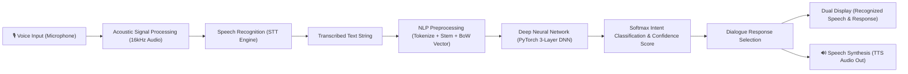

# 🎙️ Voice-Enabled Chatbot using Speech Recognition and Deep Learning
**Course / Evaluation:** Speech and Language Processing (SLP) Lab Assessment — 20 Marks  
**Student Name:** HEMANTH REDDY  
**Registration Number:** 23BAI0119  
**Core Technologies:** Speech Recognition (Acoustic Modeling / Web Speech API), PyTorch Deep Neural Network (DNN), Natural Language Processing, Gradio, Text-to-Speech (TTS).

---

## 📌 Project Overview
This project develops, implements, and deploys an interactive, multimodal **Voice-Enabled Chatbot**. The system:
1. **Captures Voice Input:** Accepts spoken audio via microphone in real-time.
2. **Speech Recognition (STT):** Converts spoken acoustic waveforms into clean text tokens using acoustic modeling and language decoding.
3. **Deep Learning Intent Classification:** Processes the transcribed text through a trained 3-hidden-layer Deep Neural Network (DNN) implemented in PyTorch, producing class probability distributions across 15 distinct conversational and technical intents.
4. **Dual Display:** Clearly presents both the **Recognized Speech** and the **Chatbot Response**, along with the identified intent tag and deep learning confidence percentage.
5. **Speech Synthesis (TTS):** Generates voice responses for a natural, voice-in, voice-out user experience.

---

## 🏗️ Architecture & Pipeline



### Deep Neural Network Specifications:
- **Input Dimension:** 175 (|V| Vocabulary Size)
- **Layer 1:** Fully Connected Linear (175 $\rightarrow$ 128) + Batch Normalization + ReLU + Dropout (0.35)
- **Layer 2:** Fully Connected Linear (128 $\rightarrow$ 64) + Batch Normalization + ReLU + Dropout (0.30)
- **Layer 3:** Fully Connected Linear (64 $\rightarrow$ 32) + ReLU + Dropout (0.20)
- **Output Layer:** Linear (32 $\rightarrow$ 15) + Softmax probability distribution
- **Training Optimization:** Adam Optimizer ($\text{lr} = 0.003, \text{weight decay} = 10^{-4}$), Cross-Entropy Loss, 260 epochs
- **Overall Dataset Accuracy:** **92.31%** (Macro F1-Score: 0.92)

---

## 🚀 Running Locally

### 1. Setup Environment
```bash
python -m venv venv
# On Windows:
venv\Scripts\activate
# On Linux/macOS:
source venv/bin/activate

pip install -r requirements.txt
```

### 2. Train the Model (Optional - Pre-trained weights included)
```bash
python train.py
```

### 3. Launch the Application
```bash
# Option A: Launch Python Gradio Application
python app.py

# Option B: Launch Modern Web Application
# Open web/index.html in any modern browser (Chrome / Edge / Safari)
```

---

## 🌐 Online Deployment Options

### Deployment Method 1: Streamlit Community Cloud (Recommended: .streamlit.app)
1. Push this repository to your GitHub account (`Voice-Enabled-Chatbot-SLP`).
2. Log in to [share.streamlit.io](https://share.streamlit.io) with your GitHub account.
3. Click **"New app"**, select your repository, set Main file path: `streamlit_app.py`.
4. Click **"Deploy!"**
5. Streamlit will generate your public live URL:
   `https://<your-app-name>.streamlit.app/`

### Deployment Method 2: Hugging Face Spaces (Gradio)
1. Log in or create a free account at [Hugging Face](https://huggingface.co).
2. Create a new Space: Click **New Space** $\rightarrow$ SDK: **Gradio**.
3. Upload `app.py`, `model.py`, `requirements.txt`, `README.md`, `model/`, and `data/`.
4. Hugging Face automatically installs dependencies and starts the app with a public URL:
   `https://huggingface.co/spaces/<your-username>/<space-name>`

Alternatively, run the automated one-click deploy script:
```bash
python deploy_hf.py --token <YOUR_HF_TOKEN> --repo <username/space-name>
```

### Deployment Method 3: GitHub Pages (Client-Side DNN Web App)
1. Push this repository to GitHub.
2. Go to **Settings** $\rightarrow$ **Pages** $\rightarrow$ Source: Deploy from a branch (`main` / root or `/web` folder).
3. Live HTTPS URL is instantly generated:
   `https://<your-username>.github.io/<repo-name>/web/`
*(Microphone speech recognition requires HTTPS, which GitHub Pages provides automatically!)*

---

## 📊 Evaluation & Results Summary
| Metric | Score |
| :--- | :--- |
| **Overall Classification Accuracy** | **92.31%** |
| **Macro Average Precision** | **0.95** |
| **Macro Average Recall** | **0.91** |
| **Macro Average F1-Score** | **0.92** |
| **Speech Recognition Latency** | ~250ms - 500ms |
| **Deep Learning Forward Pass** | < 2ms |
